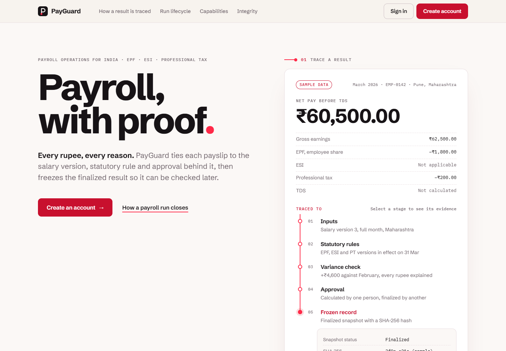

# PayGuard

> Payroll you can verify: explainable payslips, tamper-evident records, and exception review before anything is locked.

PayGuard is a full-stack payroll platform (React, Node.js/Express, MongoDB) for Indian statutory payroll. Every finalized payslip is an immutable, hash-verified record that carries the exact rule versions it was calculated with, and every business action is written to a tamper-evident audit chain.



---

## What it does

**Payroll operations**
- Calendar-month payroll runs with a strict state machine: draft → preflight → calculate → review → finalize
- Preflight blocks employees with missing salary, work state or statutory rules — never assumes defaults
- **Variance review** before finalizing: every pay change is broken into components and matched to a proven cause (salary revision, rule change, month-specific tax, enrolment or work-state change); changes with no cause are flagged as unexplained
- **Payroll register**: gross, net, cost to company, statutory totals by department
- Atomic finalization that materializes, verifies and locks payslips
- Automatic recovery of runs stuck after a crash

**Explainable, verifiable payslips**
- Every deduction shows its formula with real numbers, the rule version, rounding and month-specific rules
- Payslips re-check their own arithmetic and verify their SHA-256 hash
- Finalized payslips cannot be changed; historical inputs are frozen, so later salary or rule changes never alter them

**Compliance**
- Versioned EPF, ESI and professional tax rules (effective-dated; history keeps the version it used)
- Statutory rounding (EPF nearest rupee, ESIC round-up) and month-specific PT (e.g. Maharashtra February)
- Versioned salary structures, with a warning when a revision lands inside an already finalized period (arrears due)


**Compensation control plane**
- **Component catalogue** with semantics, not labels: type, recurrence, calculation method, and how income tax, PF wage, ESI wage, professional tax, CTC and the payslip treat each component. Statutory components are system-managed: their amounts always come from versioned compliance rules
- **Effective-dated compensation versions** per employee, each line recording how its amount was derived (`40% of BASIC ₹30,000.00 = ₹12,000.00`); components are evaluated in dependency order and a loop is refused
- **CTC, gross and net kept apart**: gross is recurring earnings, net is gross less employee deductions, CTC is gross plus employer contributions
- **Impact preview before approval**: monthly gross, deductions, net pay, employer contributions and annual CTC as before / after / change, the payroll period it lands in, and what a reviewer must know (mid-period dates, ESI eligibility, PF ceiling, arrears)
- **Change workflow**: proposed → submitted → approved (or scheduled for a future date), with maker-checker, a recorded reason, and an idempotent approval
- Components payroll does not pay yet (bonus, voluntary PF, gratuity) are labelled as such everywhere they appear

**Employee 360**
- **Effective-dated employment history**: joining, promotion, transfer, manager, location, employment type, confirmation and exit are appended as versions; earlier versions are never edited, so "what was true on date D" has one answer
- **Statutory identifiers** (PAN, UAN, ESIC number, PF member ID) and **salary bank accounts**, versioned, encrypted at rest (AES-256-GCM, bound to company, employee and field), masked in every read API
- **Audited reveal**: decrypted values only with the `sensitive.read` permission and a written reason, recorded in the audit trail before the value is returned; never written to logs, audit records or stored API responses
- PAN unique per company; one bank account used by several employees is flagged (blind indexes, no decryption)
- **Structured documents** with a verification workflow: whoever records a document cannot verify it
- **Payroll readiness** per employee and company: READY / WARNING / BLOCKED with reasons, using the same eligibility decision as payroll calculation
- Payroll preparers cannot change bank accounts; HR cannot run payroll (segregation of duties)

**Employees**
- Company-scoped employee records with soft delete (archive and restore)
- Employee self-service: own finalized payslips, fully explained

**Controls**
- Permission-based roles: administrator, payroll administrator, payroll approver, HR manager, auditor, employee
- Maker-checker: under the company setting, whoever calculates a run cannot finalize it
- Unexplained pay changes block finalization; approvers can override only with a recorded reason
- `Idempotency-Key` on every money-affecting action, so retries never act twice
- Every error carries a machine-readable `code` and request ID

**Security and audit**
- HttpOnly session cookies, sessions re-validated on every request, sign out on all devices
- Per-company data isolation (foreign records return 404)
- Account lockout, rate limits, MongoDB operator-injection guard, security headers
- Append-only, hash-chained audit log with on-demand chain verification

### Not yet included

Income tax (TDS), attendance / loss of pay, arrears calculation, payouts and statutory filings are **not built**. Payslips say so explicitly. Employee documents are records with a SHA-256 fingerprint; the files themselves are not stored yet. Exit proration and full and final settlement are not modelled. Compensation can represent bonuses, voluntary deductions and employer contributions, but payroll does not pay or deduct them yet. See [docs/COMPETITIVE-STRATEGY.md](./docs/COMPETITIVE-STRATEGY.md) for the roadmap.

---

## Local development

### Requirements
- Node.js 18+
- MongoDB 6.0+ (partial indexes use `$in`)

PayGuard requires a MongoDB **replica set** in every environment: financial writes are transactional, and development, tests and production share the same semantics. MongoDB Atlas is a replica set. Locally, a single-node replica set is enough:

```powershell
cd backend
npm run db:start            # mongod --replSet rs0 on 127.0.0.1:27018, data in %LOCALAPPDATA%\PayGuard\mongo-rs
# MONGO_URI=mongodb://127.0.0.1:27018/employee_management?replicaSet=rs0
```

The server refuses to start without transactions. `REQUIRE_TRANSACTIONS=false` is an explicit escape hatch for non-production use only (payroll writes are then **not** atomic); it is ignored when `NODE_ENV=production`.

Moving an existing standalone database onto the replica set (read-only on the source; refuses a non-empty target; documents copied unchanged, so snapshot hashes and the audit chain still verify):

```bash
npm run db:copy -- mongodb://127.0.0.1:27017/employee_management "mongodb://127.0.0.1:27018/employee_management?replicaSet=rs0"
```

### Backend

```bash
cd backend
cp .env.example .env        # set MONGO_URI and a 32+ character JWT_SECRET
npm install
npm run seed:compliance     # baseline EPF, ESI, Maharashtra PT rules
npm run dev:windows         # or: npm run dev
```

Upgrading a database created before Phase 12:

```bash
npm run migrate:dry-run
npm run migrate
```

### Frontend

```bash
cd frontend
cp .env.example .env
npm install
npm run dev
```

### Tests

```bash
cd backend
npm test                 # replica set on 127.0.0.1:27018, transactions required

cd ../frontend
npm run test:e2e         # browser tests: starts its own backend (5100, payguard_e2e) and Vite (5174)
```

The backend suites (505 tests) run against real, isolated MongoDB databases with transactions required, including the rollback and race tests that prove finalization is atomic. Nothing is skipped: a database without transactions fails the suite.

The browser suite (Playwright) drives the critical workflows through the real UI: owner registration, maker-checker payroll close with a recorded variance override, permission-based screens, Employee 360 (masked identifiers, audited reveal, readiness, segregated document verification), and a compensation change proposed with its impact and approved by a second person. It uses a disposable `*_e2e` database that is reset before and dropped after the run; locally it uses the installed Microsoft Edge, in CI Playwright's Chromium.

CI (`.github/workflows/ci.yml`) runs both suites on a MongoDB replica set for every push.

---

## API overview

| Area | Endpoints |
|---|---|
| Auth | `POST /api/auth/register`, `/login`, `/logout`, `/logout-all`; `GET /api/auth/me` |
| Employees | `GET/POST /api/employees`, `GET/PUT/DELETE /api/employees/:id`, `POST /api/employees/:id/restore`, `GET /api/employees/stats` |
| Salary | `GET /api/employees/:id/salary`, `GET …/salary/current`, `POST /api/employees/:id/salary` |
| Employee 360 | `GET/POST /api/employees/:id/employment`; `GET/POST …/statutory`, `POST …/statutory/reveal`; `GET/POST …/bank-accounts`, `POST …/bank-accounts/:accountId/reveal`; `GET/POST …/documents`, `POST …/documents/:documentId/decision`; `GET …/payroll-readiness` |
| Compensation | `GET /api/employees/:id/compensation`, `POST …/compensation/impact-preview`, `GET/POST …/compensation/changes`; `GET/POST /api/compensation/components`, `PATCH/DELETE /api/compensation/components/:code`; `GET /api/compensation/changes`, `GET /api/compensation/changes/:id`, `POST …/submit`, `…/approve`, `…/reject`, `…/cancel` |
| Payroll readiness | `GET /api/payroll-readiness?periodYear=&periodMonth=` |
| Login accounts | `POST /api/employee-accounts`, `GET /:employeeId`, `PATCH /:employeeId/status` |
| Company | `GET /api/company`, `PATCH /api/company/settings`, `GET/POST /api/company/users`, `PATCH /api/company/users/:userId` |
| Payroll runs | `GET/POST /api/payroll-runs`, `GET /:id`, `POST /:id/preflight`, `/process`, `/finalize`, `/cancel`, `/recover`; `GET /:id/register`, `/:id/variance`, `/:id/finalization-readiness` |
| Payslips | `GET /api/payroll-runs/:runId/snapshots`, `GET /api/payroll-snapshots/:id`, `/verify`, `/explain` |
| Self-service | `GET /api/me/payslips`, `GET /api/me/payslips/:id` |
| Compliance & audit | `GET /api/compliance/rules`, `GET /api/audit/logs`, `GET /api/audit/verify` |
| Operations | `GET /api/health` (liveness), `GET /api/ready` (readiness) |

---

## Architecture

```text
React + Vite ── Axios (HttpOnly cookie) ──▶ Express
                                             │  request ID · security headers · CORS · rate limits · injection guard
                                             │  auth (DB-verified session) · role checks · company scoping
                                             ▼
                              Controllers ─▶ Services ─▶ Repositories / Models
                                             │
                  payroll state machine · statutory calculator · snapshot engine
                  insights (register, variance) · payslip explainer · audit chain
                                             │
                                             ▼
                                   MongoDB (replica set)
```

Key design decisions:
- **Staging is the historical boundary.** Calculation freezes employee identity, salary, inputs, results and rule parameters. Finalization reads only that frozen data.
- **Guards at the model layer.** Soft-delete filtering, snapshot immutability, the append-only audit log and the payroll state machine are enforced on every Mongoose write, not just in services.
- **One transaction helper.** `utils/transaction.js` owns atomicity, retries and the replica-set requirement.

## Documentation

- [Forensic audit report](./PAYGUARD_FORENSIC_AUDIT_REPORT.md)
- [Phase 12 remediation report](./docs/PHASE12-REMEDIATION-REPORT.md)
- [Wave 1 foundation report](./docs/WAVE1-FOUNDATION-REPORT.md) — transactions, RBAC, controls, idempotency, error codes
- [Wave 1.5 and Wave 2 report](./docs/WAVE2-EMPLOYEE-360-REPORT.md) — transaction-safe runtime, browser tests, Employee 360, sensitive data, payroll readiness
- [Wave 3 report](./docs/WAVE3-COMPENSATION-REPORT.md) — compensation components, lineage, CTC, impact preview, change workflow
- [Competitive position and roadmap](./docs/COMPETITIVE-STRATEGY.md)

## Author

Sarthak Kadam
