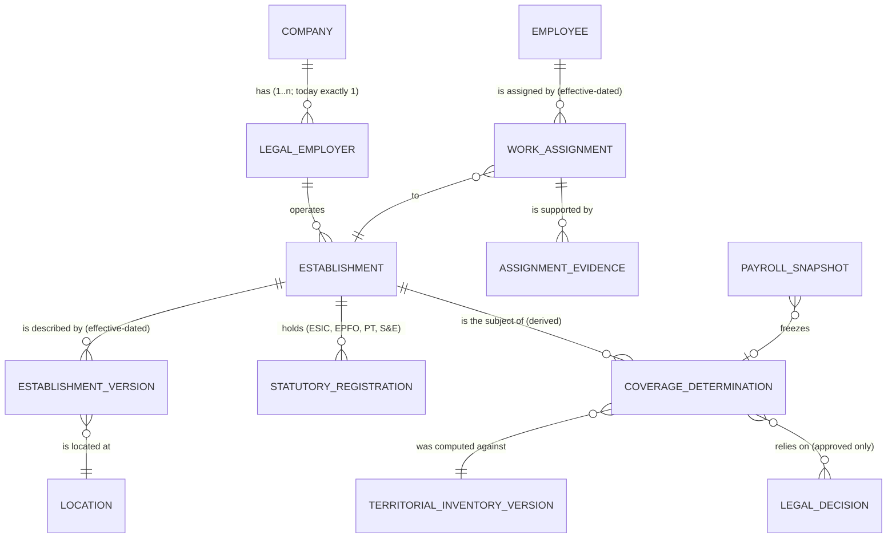

# Establishment, branch and work-assignment domain — DESIGN ONLY

Status: **design proposal, not implemented.** No schema, migration, API or payroll change is authorized by this document. It exists because every Code-era statutory determination (ESI territorial coverage, establishment applicability, contribution-period continuity) needs facts PayGuard does not store today, and the Phase 1D scaffold therefore blocks every production determination (`ESTABLISHMENT_COVERAGE_STATE_UNRESOLVED`, `ESTABLISHMENT_LOCATION_UNRESOLVED`).

Legal questions this design depends on are listed in §9 and stay open; the design is shaped so that none of them is answered implicitly by a data default.

## 1. What exists today (source review, commit `b0e3656`)

| Concept | Where | Limitation |
|---|---|---|
| Legal employer | `Company` (one per tenant; `_id` = owner admin id) | One legal entity per workspace; no registration identifiers (no ESIC employer code, no EPFO establishment id, no PAN/TAN of the employer) |
| Home address | `Employee.address {street, city, state, zipCode, country}` | Free text; a residence, **never** evidence of a workplace |
| Work location | `EmploymentRecord.workLocation {name, state}` (effective-dated) | Free-text name; state only (no district, no establishment link) |
| PT jurisdiction | `CompensationVersion.workState` / `SalaryStructure.workState` (required, no default), frozen into `PayrollSnapshot.workState` | A **second, independent** source of the work state, attached to pay rather than to employment; nothing keeps it consistent with `EmploymentRecord.workLocation.state` |
| Establishment, branch, district, territorial notification | — | Not modelled |

Consequences: PayGuard cannot say which establishment an employee works in, which district that establishment is in, or which territorial notification (if any) covers it; and the PT state can silently disagree with the employment record.

## 2. Design principles

1. **Facts, not defaults.** Unknown, disputed or missing facts are stored as such and block dependent determinations. No field defaults to a jurisdiction, a coverage state or an establishment.
2. **Workplace, not residence.** A home or registered-office address never stands in for the place of work.
3. **Effective dating everywhere.** Every fact that can change (address of an establishment, an assignment, a registration) is versioned with `effectiveFrom`/`effectiveTo`; history is appended, never edited.
4. **Determinations are derived and frozen.** A coverage determination is computed from facts + approved legal decisions + a territorial-inventory version, stored with its inputs' identifiers, and frozen into the payroll snapshot. Recomputation produces a new determination; it never edits an old one.
5. **One source of truth per fact.** The work state used for PT is derived from the work assignment, not entered separately on pay.
6. **Tenant isolation.** Every record carries `companyId`; uniqueness constraints are per tenant except where a statutory identifier is globally unique by law (still stored per tenant, compared per tenant).

## 3. Entities

## 4. Data dictionary (proposed fields)

**LegalEmployer** — `_id`, `companyId`, `legalName`, `entityType` (company/LLP/partnership/proprietorship/other), `pan` (encrypted, as statutory identifiers today), `cin`/`llpin` (optional), `createdAt`, `recordedBy`. Today: exactly one per company, created from the company record during migration (§7) with every statutory field `null`.

**Establishment** — `_id`, `companyId`, `legalEmployerId`, `code` (tenant-unique short code), `displayName`, `kind` (registered office / factory / branch / site / remote-hub / other), `status` (ACTIVE / CLOSED), `openedOn`, `closedOn`. Identity only; descriptive facts live in versions.

**EstablishmentVersion** — `establishmentId`, `companyId`, `effectiveFrom`, `effectiveTo`, `locationId`, `activityDescription`, `headcountBand` (as declared, with source), `factsStatus` per fact (`DECLARED` / `VERIFIED` / `DISPUTED` / `UNKNOWN`), `evidenceRefs[]`, `recordedBy`, `recordedAt`, `reason`.

**Location** — `_id`, `companyId`, `addressLines`, `pincode`, `stateCode` (ISO 3166-2:IN), `districtCode` (LGD district code), `districtName`, `subDistrictCode` (optional), `geocodeSource` (optional), `verificationStatus`. District is required for ESI territorial matching; a location without a verified district blocks.

**StatutoryRegistration** — `establishmentId`, `companyId`, `scheme` (ESIC / EPFO / PT-<state> / SHOPS-<state> / other), `identifier` (encrypted where sensitive), `effectiveFrom`, `effectiveTo`, `status` (APPLIED / REGISTERED / SURRENDERED / UNKNOWN), `evidenceRefs[]`. A registration is a fact about the establishment, not proof of legal coverage.

**WorkAssignment** — `_id`, `employeeId`, `companyId`, `establishmentId`, `effectiveFrom`, `effectiveTo`, `assignmentType` (PRIMARY / SECONDARY / TEMPORARY_TRANSFER / DEPUTATION / REMOTE), `share` (optional fraction of time, for multiple concurrent assignments), `reason`, `evidenceRefs[]`, `recordedBy`, `recordedAt`, `supersedes` (previous assignment id, for corrections). Corrections append a new record; nothing is edited in place.

**AssignmentEvidence** — `kind` (appointment letter / transfer order / attendance-site record / declaration), `documentId` (existing `EmployeeDocument`), `recordedAt`.

**TerritorialInventoryVersion** — immutable snapshot of the verified territorial notification register: `version`, `generatedAt`, `sourceManifestHash`, `enumerationComplete` (boolean; today `false`), `notifications[]` (S.O. number, date, effective date, districts, supersession links, artifact hash).

**CoverageDetermination** (derived) — `establishmentId`, `periodStart`, `periodEnd`, `scheme`, `result` (COVERED / NOT_COVERED / BLOCKED), `blockCodes[]`, `inputs` (establishment version id, location id, inventory version, legal-decision ids and their approval references), `computedAt`, `engineVersion`, `hash`. Immutable.

## 5. Relationships and cardinality

- Company 1 — 1..n LegalEmployer (1 today; the model must not assume 1).
- LegalEmployer 1 — 0..n Establishment.
- Establishment 1 — 1..n EstablishmentVersion; versions of one establishment never overlap in time.
- Employee 1 — 0..n WorkAssignment; at most **one PRIMARY** assignment effective on any date; any number of SECONDARY/TEMPORARY assignments, each with a non-overlapping interval per establishment.
- WorkAssignment n — 1 Establishment, and the establishment must belong to the same company (tenant check enforced at write time and by a compound index including `companyId`).

## 6. Invariants

1. A payroll determination for an employee and period uses the PRIMARY assignment(s) effective in that period; if none, or more than one PRIMARY overlaps, the determination **blocks** (`WORK_ASSIGNMENT_MISSING` / `WORK_ASSIGNMENT_AMBIGUOUS`). It never falls back to the employee's home address, to the registered office, or to the most recent assignment.
2. A period that crosses an assignment change, an establishment-version change or a territorial effective date is segmented; segmentation semantics are a legal decision (D14) and block until approved.
3. Assignment and establishment history is append-only; a correction is a new record that supersedes, with a reason and actor, and is audited (audit event in the same transaction, per the atomicity rules).
4. The PT state is derived from the PRIMARY assignment's location; a direct `workState` on pay is retained only for historical snapshots and is compared, not trusted, during migration (§7).
5. A CoverageDetermination is reproducible from its stored inputs; changing any input produces a new determination with a new hash.
6. No determination can be COVERED or NOT_COVERED while `TerritorialInventoryVersion.enumerationComplete` is `false` or any required legal decision lacks an approval reference (the Phase 1D rule, preserved).

## 7. Migration strategy (when, and only when, authorized)

1. Additive collections only; no existing field is removed or rewritten.
2. Create one LegalEmployer per Company with all statutory fields `UNKNOWN`.
3. **No establishments are invented.** For each distinct `EmploymentRecord.workLocation {name, state}` the migration produces a *proposal* report (not records). An operator creates establishments and locations (with district) from evidence.
4. Work assignments are created from operator-confirmed mappings of existing employment records to establishments; unmapped employees remain unassigned and every dependent determination blocks.
5. A consistency report lists every employee whose `CompensationVersion.workState` differs from the proposed assignment's state; nothing is auto-corrected.
6. Finalized payroll snapshots are never touched; they keep their frozen `workState`.

## 8. API implications

New read/write endpoints under `/api/establishments` and `/api/employees/:id/work-assignments`, permission-gated (`company.manage` for establishments, `employee.write` for assignments), Idempotency-Key required on writes, every write audited in the same transaction. Read models expose `factsStatus` and block codes so the UI shows "unknown" and "blocked" honestly. The PT-state input on compensation forms becomes read-only (derived) after migration.

## 9. Open legal questions (from the Phase 1D legal decision register; none answered here)

- D15: establishment-level applicability (First Schedule) and the evidence standard for the work-location link.
- D11: coverage anchor, employee status and continuity (s.2(26), S.O. 2351(E)).
- D14: rule-effective-date and period segmentation.
- D1/D2: territorial supersession and inventory completeness.
- D16: legacy ESI Act continuation for areas without a Code-era notification.
- Whether remote/work-from-home employees are attached to an establishment, and which.
- Treatment of an employee with concurrent assignments in establishments with different coverage states.

## 10. Test strategy (for the future implementation)

Property tests over generated assignment histories (no overlapping PRIMARY; segmentation boundaries exact); tenant-isolation tests (an assignment to another company's establishment is refused at the database and the service); determinism tests (same inputs → same determination hash); block-code tests for every missing or disputed fact; migration dry-run tests on copies of real-shaped data asserting that no establishment is created without an operator decision; golden-snapshot tests proving historical snapshots are byte-identical after migration.
